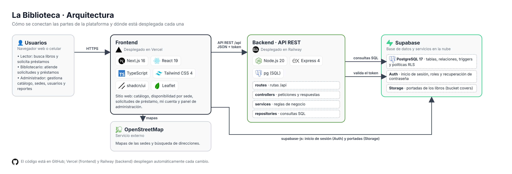
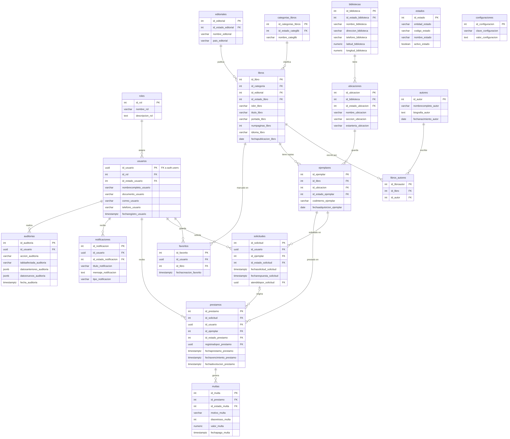

# 📚 La Biblioteca
 
Plataforma web para que las redes de bibliotecas de Colombia gestionen su catálogo y sus sedes, y para que los usuarios consulten la disponibilidad de los libros y soliciten préstamos en línea.
 
🔗 **Sitio web:** [la-biblioteca-ten.vercel.app](https://la-biblioteca-ten.vercel.app/)
 
Proyecto de grado de la media técnica en Soporte, Mantenimiento y Visualización de Bases de Datos (I.E. INEM José Félix de Restrepo, en articulación con el ITM).
 
---
 
## 🧩 El problema
 
Muchas bibliotecas de Colombia, entre ellas varias de Medellín, trabajan con bases de datos antiguas y poco gestionadas. Esto genera tres dificultades:
 
1. **Información difícil de administrar:** los datos son poco confiables, sobre todo cuando una red tiene varias sedes.
2. **Catálogo invisible en línea:** es difícil saber si un libro está disponible, en qué sede, en qué idioma y con qué características. Muchas veces el usuario tiene que ir a la sede para averiguar si el libro existe.
3. **Préstamos solo presenciales:** para pedir un libro hay que ir a la biblioteca.
 
## 🎯 El objetivo
 
Desarrollar una plataforma web que permita a las redes de bibliotecas de Colombia administrar su catálogo y sus sedes en una base de datos confiable, y que los usuarios consulten la disponibilidad de los libros y soliciten préstamos desde su casa, sin ir a la sede para averiguarlo.
 
## 💡 La solución
 
**La Biblioteca** es un sitio web con dos partes: un catálogo público para los lectores y un panel de administración para el personal de las bibliotecas.
 
- **Catálogo en línea:** búsqueda y filtros por categoría, autor y año. Cada libro tiene su ficha con idioma, editorial, páginas, ISBN y portada, y muestra la disponibilidad de cada ejemplar por sede y ubicación (sección y estantería).
- **Préstamos en línea:** el lector solicita el libro desde su casa. El bibliotecario revisa que cumpla las condiciones y el lector recibe una notificación de aprobación o rechazo. Después retira el libro en la sede, puede renovar el préstamo, y si se retrasa en la devolución se le genera una multa.
- **Varias sedes en una plataforma:** cada sede tiene su información y su ubicación en el mapa.
- **Panel de administración por roles** (Administrador, Bibliotecario y Lector): gestión de libros, ejemplares, autores, editoriales, categorías, sedes, usuarios, préstamos, multas, reportes y auditoría.
 
## 🛠️ Tecnologías
 
| Capa | Tecnologías |
|---|---|
| Frontend | Next.js 16, React 19, TypeScript, Tailwind CSS 4, shadcn/ui, Leaflet + OpenStreetMap |
| Backend | Node.js 20, Express 4, pg (SQL sin ORM), arquitectura en capas |
| Base de datos y servicios | Supabase: PostgreSQL 17, Auth y Storage |
| Despliegue | Vercel (frontend), Railway (backend), GitHub |
 
## 🏗️ Arquitectura
 

 
- El **frontend** (Next.js, en Vercel) es el sitio que usan lectores y personal. Consume la API del backend y usa Supabase directamente para iniciar sesión y mostrar las portadas.
- El **backend** (Node.js y Express, en Railway) expone una API REST en `/api`, organizada en capas: `routes` → `controllers` → `services` → `repositories`. Valida cada sesión con Supabase Auth y consulta PostgreSQL con SQL puro.
- **Supabase** aloja la base de datos PostgreSQL 17, la autenticación de usuarios y las portadas de los libros (bucket `covers`).
- Los mapas de las sedes usan **OpenStreetMap**.
 
## 🗃️ Modelo relacional
 

 
La base de datos tiene **18 tablas** en PostgreSQL 17:
 
- **Catálogo:** `libros`, `autores`, `libros_autores` (relación muchos a muchos), `editoriales`, `categorias_libros` y `ejemplares` (cada copia física de un libro).
- **Sedes:** `bibliotecas` y `ubicaciones` (sección y estantería donde está cada ejemplar).
- **Préstamos:** `solicitudes` → `prestamos` → `multas`.
- **Usuarios:** `usuarios` (vinculada a Supabase Auth), `roles`, `favoritos` y `notificaciones`.
- **Control:** `estados` (catálogo de estados de todas las entidades), `auditorias` y `configuraciones`.
 
Por claridad, el diagrama muestra las columnas principales y no dibuja las relaciones con `estados`: cada tabla que tiene una columna `id_estado_*` se relaciona con ella. La base de datos usa **triggers** para mantener la coherencia de los datos y **políticas RLS** (Row Level Security) para proteger la información.
 
## 👤 Mi rol en el proyecto
 
**Emmanuel Sánchez Ossa** · Desarrollador en un equipo de 4 personas. Mi aporte principal fue la lógica, la base de datos y el diseño.
 
- **Lógica:** lógica de funcionamiento de la plataforma.
- **Base de datos:** diseño del modelo relacional en PostgreSQL, triggers para mantener la coherencia de los datos y optimización de índices.
- **Diseño:** diseño de la plataforma.
- **Dashboard de indicadores:** cuando los portátiles del colegio no soportaban crear los dashboards, propuse usar Looker Studio, una herramienta en línea, y con él construimos el dashboard.
- **Reconocimiento:** evaluadores del ITM calificaron La Biblioteca como el mejor proyecto a nivel técnico entre 4 (noviembre de 2026).
 
[LinkedIn](https://www.linkedin.com/in/emmanuel-sanchez-ossa) · [GitHub](https://github.com/Nuelso-dev)
 
## 📁 Estructura del repositorio
 
```
la-biblioteca/
├── frontend-biblioteca/      # Sitio web (Next.js)
├── backend-biblioteca/       # API REST (Node.js + Express)
│   └── scripts/              # Optimización de índices y datos de simulación
├── migration_supabase.sql    # Esquema de la base de datos
├── docs/                     # Diagramas del README
├── compartir.ps1 / .cmd     # Arranca todo en local (y con túneles públicos)
├── detener.cmd               # Apaga backend, frontend y túneles
└── DEPLOY.md                 # Guía de despliegue (Vercel, Railway y Supabase)
```
 
## 💻 Cómo ejecutarlo en local
 
**Requisitos:** Node.js 20 o superior, [pnpm](https://pnpm.io/installation) y un proyecto de Supabase con la base de datos creada (ver [DEPLOY.md](DEPLOY.md)).
 
**1. Clonar el repositorio**
 
```bash
git clone https://github.com/Nuelso-dev/la-biblioteca.git
cd la-biblioteca
```
 
**2. Backend (API en el puerto 3001)**
 
```bash
cd backend-biblioteca
pnpm install
cp .env.example .env
```
 
Completa `.env` con los datos de tu proyecto de Supabase:
 
| Variable | Valor |
|---|---|
| `PORT` | `3001` |
| `DATABASE_URL` | Cadena de conexión del *pooler* de Supabase en modo Transaction (puerto 6543) |
| `SUPABASE_URL` | URL del proyecto de Supabase |
| `SUPABASE_ANON_KEY` | Clave pública (anon) del proyecto |
| `CORS_ORIGIN` | `http://localhost:3000` |
 
```bash
pnpm dev
```
 
Comprueba que responde en [http://localhost:3001/api/health](http://localhost:3001/api/health).
 
**3. Frontend (sitio web en el puerto 3000)**
 
En otra terminal:
 
```bash
cd frontend-biblioteca
pnpm install
```
 
Crea el archivo `.env.local` con:
 
```env
NEXT_PUBLIC_API_URL=http://localhost:3001/api
NEXT_PUBLIC_SUPABASE_URL=https://TU_PROYECTO.supabase.co
NEXT_PUBLIC_SUPABASE_ANON_KEY=TU_ANON_KEY_PUBLICO
```
 
```bash
pnpm dev
```
 
Abre [http://localhost:3000](http://localhost:3000).
 
**Atajo en Windows:** con los dos archivos `.env` ya creados, `compartir.ps1 -Local` arranca backend y frontend en localhost. Sin `-Local`, también abre túneles de Cloudflare para compartir una URL pública temporal (requiere `cloudflared`). Para apagar todo: doble clic en `detener.cmd`.
 
## 🚀 Despliegue
 
Los pasos para crear la base de datos en Supabase, desplegar el backend en Railway y el frontend en Vercel están en [DEPLOY.md](DEPLOY.md).
 
